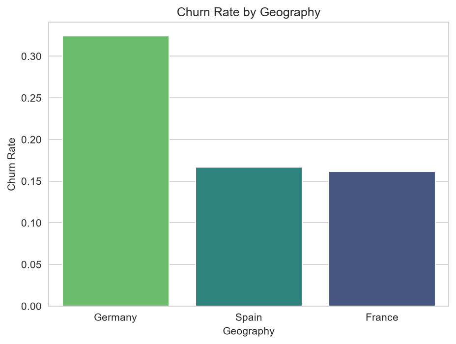

# Bank Customer Churn & Risk Report
_Generated: 2026-08-25 16:56_

## Executive Summary

- **Overall churn rate:** 20.37%
- **Highest-churn geography:** Germany (32.44% churn)
- **Highest-churn age band:** 51-60 (56.21% churn)
- **Inactive members churn at 26.85%** vs **14.27%** for active members
- **723 customers (7.23% of base)** flagged as High Risk by the rule-based scoring model

## Churn Rate by Geography

| geography   |   customers |   churned |   churn_rate_pct |
|:------------|------------:|----------:|-----------------:|
| Germany     |        2509 |       814 |            32.44 |
| Spain       |        2477 |       413 |            16.67 |
| France      |        5014 |       810 |            16.15 |

## Churn Rate by Age Band

| age_band   |   customers |   churned |   churn_rate_pct |
|:-----------|------------:|----------:|-----------------:|
| 51-60      |         797 |       448 |            56.21 |
| 41-50      |        2320 |       788 |            33.97 |
| 60+        |         464 |       115 |            24.78 |
| 31-40      |        4451 |       538 |            12.09 |
| 18-30      |        1968 |       148 |             7.52 |

## Value at Risk by Risk Tier

| risk_tier   |   customers |   total_value_at_risk |
|:------------|------------:|----------------------:|
| Medium Risk |        4984 |           433,147,747 |
| Low Risk    |        4293 |           356,513,213 |
| High Risk   |         723 |            69,615,335 |

## Recommendations

1. **Prioritize re-engagement campaigns for inactive members** — this single factor shows the largest churn gap in the data.
2. **Investigate the highest-churn geography** for service, pricing, or competitive factors specific to that region.
3. **Target single-product customers with cross-sell offers** — low product engagement is a strong churn signal and is directly actionable.
4. **Build a retention offer track for the High Risk tier** identified above, prioritized by value at risk rather than customer count alone.